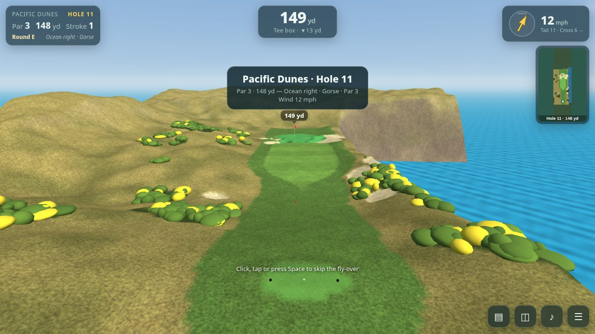
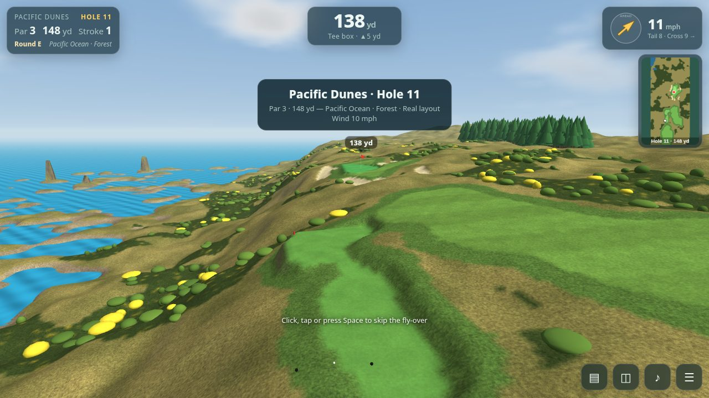
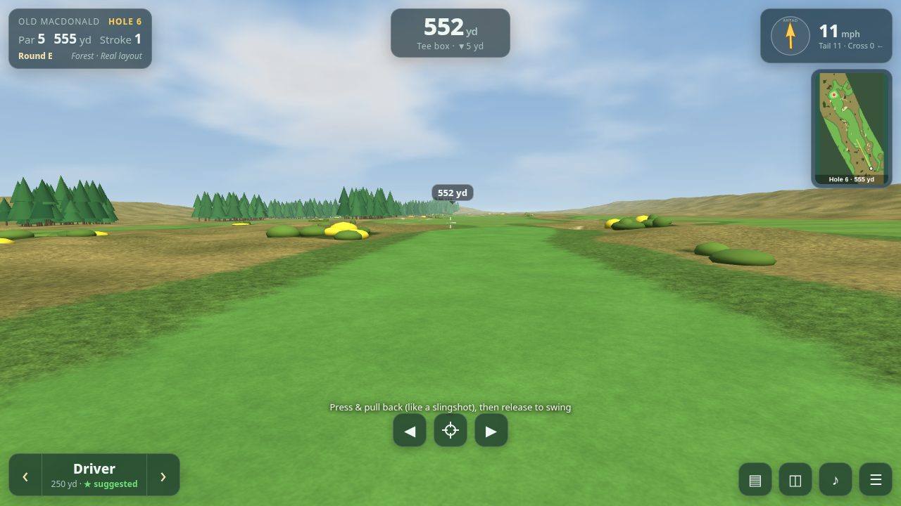
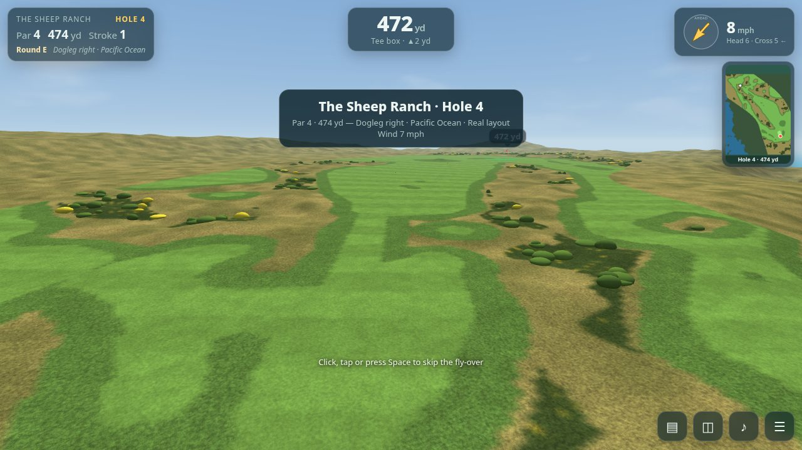

# Bandon Dunes Golf

A first-person, slingshot-style golf game set on the seven courses at Bandon Dunes (Bandon Dunes, Pacific Dunes, Bandon Trails, Old Macdonald, Sheep Ranch, Bandon Preserve, Shorty's). Pure static HTML/JS + three.js, no build step.

**Play:** https://gorillastocks.github.io/bandon-golf/

## Controls
- **Swing:** press/touch and pull back (away from the target) like a slingshot; pull length = power, pull angle = aim. Release to hit.
- **Aim:** ◀ ▶ buttons or A/D / arrow keys; P or the crosshair button aims at the pin.
- **Club:** ‹ › or W/S; mouse wheel. A club is auto-suggested from distance, elevation, wind and lie.
- **Other:** V overview map, T scorecard, M mute, Esc pause, Space fast-forward the ball.

- **Auto 2-putt:** once the ball is at rest on the green, an **Auto 2-putt** button appears. It adds 2 putts (1 if the ball is within ~3 ft — a tap-in), logs them as *auto* on the scorecard (marked with a small gold **a**), plays the crowd reaction for the resulting score and moves on to the hole summary. The pause menu has an **Auto 2-putt every green** toggle (remembered in `localStorage`) that does it automatically after each approach shot onto the green.

## Difficulty
- **Simple** – light wind, aim assist, forgiving lies, full trajectory preview, gimme putts.
- **Normal** – moderate wind with gusts, less assist, line preview.
- **Realistic** – strong gusty wind, mishits driven by how clean your pull is, no preview, full lie penalties.

Physics: drag, Magnus lift/spin, wind profile + gusts, bounce/roll by lie, green slope, cup lip-outs. Distances in yards, score vs par, scorecard and round stats are tracked.

## Real course data
Every hole on all seven courses is built from real geometry:

- **Layout** – the hole centre-line (tee → green), green, tee, bunker, fairway, rough, water-hazard and woods polygons come from [OpenStreetMap](https://www.openstreetmap.org/copyright) (© OpenStreetMap contributors, ODbL), converted to local metres with the tee at the origin and true compass orientation.
- **Terrain** – USGS NED 10 m elevation (via [OpenTopoData](https://www.opentopodata.org/), sampled on a 25 m grid, bicubic) gives the real ridges, dunes, bluffs and the Pacific shoreline; the ocean appears wherever the elevation is at sea level.
- **Scorecard** – pars and Black-tee yardages are the published numbers. Where the mapped tee polygon distance disagreed, the tee is placed at the mapped back tee (or the nearest consistent tee) so the playing length matches the scorecard.
- **Fallbacks (procedural, recorded per hole in `hole.real.fallbacks`)** – gorse and tree placement inside mapped woods, fine green contours (the DEM is too coarse), fairway where OSM has no polygon along the centre-line, tee plates / green ellipses when a polygon is missing, forests on Bandon Trails (no wood polygons there).
- Shorty's: OSM maps 19 par-3 lines but the course has 9 holes, so each of the 9 holes is matched to the mapped line with the closest scorecard yardage.

`tools/` has the scripts that fetched and packed the data into `js/realdata.js` (see `tools/README.md`). The old fully procedural builder is still available with `BG.Course.build(course, idx, diff, {procedural:true})`.

Pacific Dunes #11 — before (procedural) and after (real OSM layout + USGS terrain):

## Graphics (Low / Medium / High)
Pause menu or main menu → **Graphics** cycles *Auto → Low → Medium → High* (remembered in `localStorage` key `bg.gfx`; `?gfx=low|medium|high` overrides for one load). **Auto** picks a level per device: iPhone / small phones and software GL → Low, iPad / Android tablets and unknown GPUs → Medium, desktop with a discrete/Apple GPU → High. Changing the level re-loads textures live, no page reload.

| | Low | Medium | High |
|---|---|---|---|
| Terrain textures | 512 px albedo, no detail normals | 512 px + detail normals/roughness | 1024 px + detail normals |
| Lighting | hemisphere + sun | + sky image-based lighting, sun shadows (1024 map) | + 2048 shadow map, terrain & gorse cast shadows |
| Ocean | 2 normal layers, Fresnel sky reflection, simple shoreline foam | + 3rd layer, animated surf foam, whitecaps | same as Medium |
| Vegetation | simple trees & gorse | 2-tier spruce/pine, gorse with flowers, 5k grass tufts | 3-tier trees, 12 flowers/bush, 16k grass tufts |
| Pixel ratio cap | 1.5 | 2 | 2 |

Visual stack (`js/gfx.js`): CC0 PBR textures blended on the real surface map (fairway, green with mowing stripes, rough, deep rough, sand, gorse floor, rock on steep slopes, wet sand near the water) via a texture-array terrain shader; pre-tonemapped HDRI sky dome (clear / mist / overcast per hole) plus a tiny RGBE copy for PMREM lighting; ACES tone mapping and coastal haze; animated ocean with foam at the shoreline; instanced vertex-coloured spruce / shore pine, gorse and wind-swayed dune-grass tufts. Textures ship as WebP (~6 MB total for all levels; Low only downloads the 512 px set). KTX2 was not used because the bundled three.js r149 build has no KTX2 loader.

Assets are generated from the CC0 sources by `tools/build_assets.py` (needs Pillow/numpy and the downloaded sources); the generated files are committed in `assets/`.

Download size: Low/Medium ≈ 1.1 MB of textures (512 px WebP) + ~10–50 KB per sky; High ≈ 4.8 MB (1024 px). Measured in headless Chromium/SwiftShader (software GL, so only the *relative* cost is meaningful): draw calls 10 / 12 / 12 and ~131k / ~212k / ~361k triangles per frame on Low / Medium / High for a Bandon Dunes #16 view; relative frame cost ≈ 1.0× / 1.1× / 1.3× (Low = fewest shader features). Not measured on a real iPhone.

Before / after: `docs/desktop-tee-before.jpg` → `docs/desktop-tee-after.jpg`, `docs/landscape-tee2-before.jpg` → `docs/landscape-tee2-after.jpg`.

### Asset credits (all CC0 / public domain)
- **ambientCG** (https://ambientcg.com): Grass006 (fairway), Grass008 (green), Grass004 (rough), Rock030 (rock/cliff).
- **Poly Haven** (https://polyhaven.com): `withered_grass` (deep rough), `sand_01` (bunkers/beach), `brown_mud_leaves_01` (gorse floor).
- **Poly Haven HDRIs** by Greg Zaal (sky edits by Jarod Guest): *Kloofendal 48d Partly Cloudy (Pure Sky)*, *Kloofendal Overcast (Pure Sky)*, *Kloofendal Misty Morning (Pure Sky)*.

## Crowd reactions
All crowd audio is synthesized live with WebAudio (no samples, no third-party assets), randomised every time so it never repeats. **M** mutes it with the rest of the sound.

| Trigger | Reaction |
|---|---|
| Par; great drive (≥ ~250 yd for the Driver, scaled by difficulty, finishing in the fairway); good approach; long carry over gorse | polite golf claps |
| Birdie; approach to ≤ 8 ft from ≥ 100 yd (or ≤ 15 ft from ≥ 160 yd); carry of 50+ yd over ocean/water; holed long putt (≥ 22/30/40 ft by difficulty); holing from a bunker; chip-in/hole-out from off the green | huge cheer |
| Eagle; birdie combined with a hard shot (chip-in, long putt, from sand) | roar with whistles |
| Hole-in-one, albatross | full stadium roar |

A small callout appears under the HUD naming the moment. Audio unlocks on the first tap/click/key (iOS Safari safe).

## Host commentary
A TV-broadcast-style host talks you through each hole as the fly-over starts: par and yardage, prevailing wind, the hazards, ocean and cliffs, gorse, bunkers, and where to miss. Scripts are written from the course's published hole notes plus the in-game par/yardage.

- **Voice:** [ElevenLabs](https://elevenlabs.io) premade voice "George" (`eleven_v4`), one voice for every hole. The audio is **AI-generated** speech; it does not imitate any real person.
- **Files:** `audio/commentary/<course>/<NN>.mp3` (mono, 48 kbps, 12–23 s each, ~11 MB total) plus `audio/commentary/manifest.json` (script text and durations). Clips load lazily, and the next hole's clip is prefetched.
- **Controls:** a **Skip** button appears while the host is talking; the 🎙 button (or **C**) turns commentary on/off (remembered in `localStorage`); **M** mutes everything including the host. Commentary also stops on your first shot, on pause, and when the hole ends.
- **Holes without a clip** (the voice-generation credit quota ran out before every hole was rendered) just stay silent: see `manifest.json` for what's present.
- Audio is decoded and played through the same WebAudio graph as the other sounds and unlocks on the first tap/click/key (iOS Safari safe).
