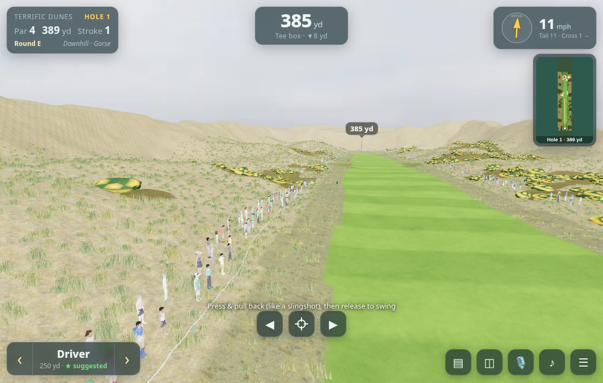
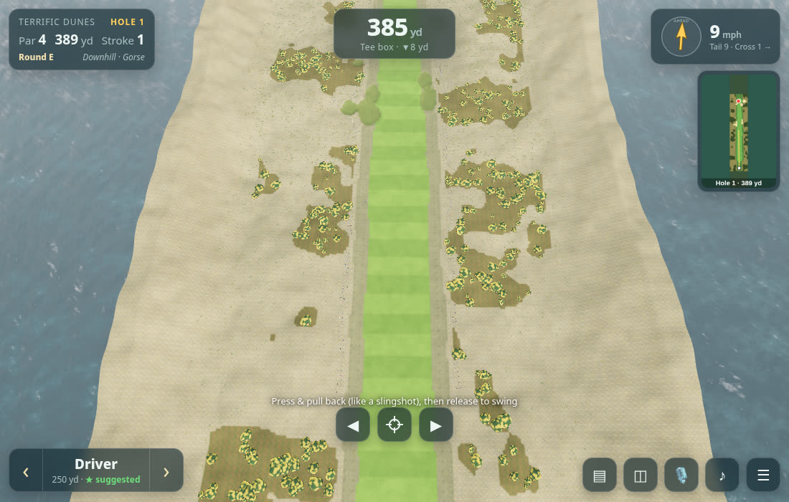
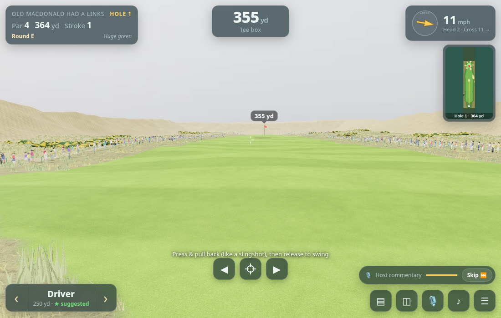
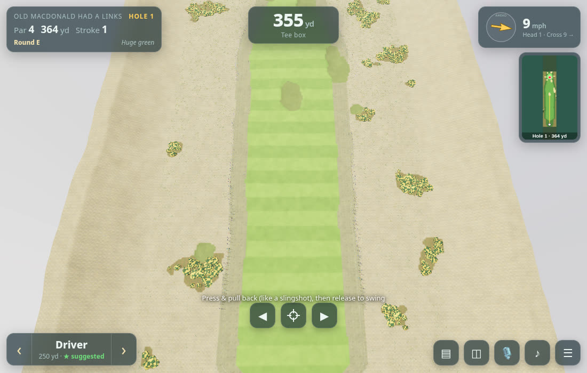

# Abandoned Dunes

A first-person, slingshot-style golf game across seven stylized, parody-named links courses on a wind-whipped coast. Pure static HTML/JS + three.js (vendored, no CDN), no build step for the web version. Also wrapped for the **Apple App Store** with Capacitor (iOS) — see [`docs/APP_STORE.md`](docs/APP_STORE.md).

**Play:** https://gorillastocks.github.io/bandon-golf/ &nbsp;·&nbsp; [Privacy policy](docs/privacy.html) &nbsp;·&nbsp; [Support](docs/support.html)

> Course names are parodies and all courses are fictional, original designs. Not affiliated with or endorsed by Bandon Dunes Golf Resort.

| Course (id) | Parody name |
|---|---|
| `bandit` | **Bandit Dunes** |
| `terrific` | **Terrific Dunes** (holes 1–5 are the free teaser) |
| `trails` | **Abandon Trails** |
| `oldmac` | **Old MacDonald Had a Links** |
| `sheep` | **Sheep Wreck** |
| `preserve` | **Preserve Us!** (13 par 3s) |
| `circuit` | **Short Circuit** (9 par 3s) |

(Course ids are used for file paths, saves and assets. Hole designs live in `js/layouts.js`.)

## iOS app (Capacitor)
`npm install && npm run ios:sync && npm run ios:open` on a Mac. Bundle id `com.gorillastocks.abandoneddunes`. Game Center leaderboards/achievements exist **only** in the iOS build (`js/gamecenter.js` + local plugin `plugins/capacitor-game-center`); the web version shows no Game Center UI.

## Controls
- **Swing:** press/touch and pull back (away from the target) like a slingshot; pull length = power, pull angle = aim. Release to hit.
- **Aim:** ◀ ▶ buttons or A/D / arrow keys; P or the crosshair button aims at the pin.
- **Club:** ‹ › or W/S; mouse wheel. A club is auto-suggested from distance, elevation, wind and lie.
- **Shot shape:** the button beside the club picker (tap to cycle) or Q/E: Big Draw / Draw / Straight / Fade / Big Fade for a right-handed golfer. A draw starts right and curves left, a fade starts left and curves right, both landing near the aim line at carry distance (driver draw ~12 yd of curve, 7-iron ~6 yd, wedges least; big shapes double it). Draw flies lower with less spin and rolls out, fade flies higher and lands softer. Normal/Realistic add a little extra dispersion to shaped shots. No shaping with the putter; resets to Straight each hole. `node tools/verify_shaping.js` checks the numbers.
- **Other:** V overview map, T scorecard, M mute, Esc pause, Space fast-forward the ball.

- **Auto 2-putt:** once the ball is at rest on the green, an **Auto 2-putt** button appears. It adds 2 putts (1 if the ball is within ~3 ft — a tap-in), logs them as *auto* on the scorecard (marked with a small gold **a**), plays the crowd reaction for the resulting score and moves on to the hole summary. The pause menu has an **Auto 2-putt every green** toggle (remembered in `localStorage`) that does it automatically after each approach shot onto the green.

## Difficulty
- **Simple** – light wind, aim assist, forgiving lies, full trajectory preview, gimme putts.
- **Normal** – moderate wind with gusts, less assist, line preview.
- **Realistic** – strong gusty wind, mishits driven by how clean your pull is, no preview, full lie penalties.

Physics: drag, Magnus lift/spin, wind profile + gusts, bounce/roll by lie, green slope, cup lip-outs. Distances in yards, score vs par, scorecard and round stats are tracked.

## Course design
All seven courses (112 holes) are original, hand-authored designs. Each hole is one row in `js/layouts.js` (par, yardage, routing, elevation profile and a few feature tokens); `js/course.js` turns that into a hole procedurally: a centre-line, a synthetic height map (layered noise plus dunes, shaped around the routing), a surface map (tee, fairway, rough, deep rough, bunkers, green, water, gorse), bunkers, gorse, trees and a coastline. No map, survey, aerial-imagery or elevation data is used anywhere in the project, and the layouts are not based on any real course.

- Check every hole headless: `node tools/verify_holes.js [courseId]` builds each of the 112 holes and checks bounds, tee/green surfaces, par/yardage, a hazard-free centre-line, and that a bot can hole out with the real physics.
- Commentary scripts are generated from the same hole table: `node tools/gen_commentary_text.js` writes `audio/commentary/texts.json`.

## Graphics (Low / Medium / High / Ultra)
Pause menu or main menu → **Graphics** cycles *Auto → Low → Medium → High → Ultra* (remembered in `localStorage` key `bg.gfx`; `?gfx=low|medium|high|ultra` overrides for one load). **Auto** picks a level per device: iPhone / small phones and software GL → Low, iPad / Android tablets and unknown GPUs → Medium, desktop with a discrete/Apple GPU → High. Changing the level re-loads textures live, no page reload.

| | Low | Medium | High |
|---|---|---|---|
| Terrain textures | 512 px albedo, no detail normals | 512 px + detail normals/roughness | 1024 px + detail normals |
| Lighting | hemisphere + sun | + sky image-based lighting, sun shadows (1024 map) | + 2048 shadow map, terrain & gorse cast shadows |
| Ocean | 2 normal layers, Fresnel sky reflection, simple shoreline foam | + 3rd layer, animated surf foam, whitecaps | same as Medium |
| Vegetation | simple trees & gorse | 2-tier spruce/pine, gorse with flowers, 5k grass tufts | 3-tier trees, 12 flowers/bush, 16k grass tufts |
| Pixel ratio cap | 1.5 | 2 | 2 |

Visual stack (`js/gfx.js`): CC0 PBR textures blended on the surface map (fairway, green with mowing stripes, rough, deep rough, sand, gorse floor, rock on steep slopes, wet sand near the water) via a texture-array terrain shader; pre-tonemapped HDRI sky dome (clear / mist / overcast per hole) plus a tiny RGBE copy for PMREM lighting; ACES tone mapping and coastal haze; animated ocean with foam at the shoreline; instanced vertex-coloured spruce / shore pine, gorse and wind-swayed dune-grass tufts. Textures ship as WebP (~6 MB total for all levels; Low only downloads the 512 px set). KTX2 was not used because the bundled three.js r149 build has no KTX2 loader.

**Ultra** (opt-in, never chosen by Auto; High stays the default) adds: a post-processing pass (4x MSAA scene target, soft bloom on sun glints and whitecaps, tilt-shift depth-of-field during fly-overs, vignette, film grade and dither), a 20k grass-tuft / 18k near-field blade budget, a denser, shadow-casting crowd, finer ocean glitter and the 3-tier tree/gorse geometry. All levels (except Low) also use heightmap-derived cavity ambient occlusion and an anti-tiling term in the terrain shader, procedural bark/needle noise on trees, gorse built from shaded clumps, a dimpled physical-material ball, a lathe-turned tee, flag cloth texture, cup rim and tee markers. Nothing in these passes touches the physics or the course layouts. The post pass costs one extra full-res MSAA colour target plus three small blur targets (see `Gfx.postStats()`), so Ultra is intended for iPad / recent iPhone Pro devices; if it is too heavy, pick High.

Assets are generated from the CC0 sources by `tools/build_assets.py` (needs Pillow/numpy and the downloaded sources); the generated files are committed in `assets/`.

Download size: Low/Medium ≈ 1.1 MB of textures (512 px WebP) + ~10–50 KB per sky; High ≈ 4.8 MB (1024 px). Measured in headless Chromium/SwiftShader (software GL, so only the *relative* cost is meaningful): draw calls 10 / 12 / 12 and ~131k / ~212k / ~361k triangles per frame on Low / Medium / High for a Bandit Dunes #16 view; relative frame cost ≈ 1.0× / 1.1× / 1.3× (Low = fewest shader features). Not measured on a real iPhone.

### Asset credits (all CC0 / public domain)
- **ambientCG** (https://ambientcg.com): Grass006 (fairway), Grass008 (green), Grass004 (rough), Rock030 (rock/cliff).
- **Poly Haven** (https://polyhaven.com): `withered_grass` (deep rough), `sand_01` (bunkers/beach), `brown_mud_leaves_01` (gorse floor).
- **Poly Haven HDRIs** by Greg Zaal (sky edits by Jarod Guest): *Kloofendal 48d Partly Cloudy (Pure Sky)*, *Kloofendal Overcast (Pure Sky)*, *Kloofendal Misty Morning (Pure Sky)*.

## Crowd reactions
All crowd audio is synthesized live with WebAudio (no samples, no third-party assets), randomised every time so it never repeats. **M** mutes it with the rest of the sound.

| Trigger | Reaction |
|---|---|
| Par; great drive (≥ ~250 yd for the Driver, scaled by difficulty, finishing in the fairway); good approach; long carry over gorse | polite golf claps |
| Birdie; approach to ≤ 8 ft from ≥ 100 yd (or ≤ 15 ft from ≥ 160 yd); carry of 50+ yd over ocean/water; holed long putt (≥ 22/30/40 ft by difficulty); holing from a bunker; chip-in/hole-out from off the green | huge cheer |
| Eagle; birdie combined with a hard shot (chip-in, long putt, from sand) | roar with whistles |
| Hole-in-one, albatross | full stadium roar |

A small callout appears under the HUD naming the moment. Audio unlocks on the first tap/click/key (iOS Safari safe).

## Tournament crowd (optional)

Pause menu / main menu → **Tournament crowd: OFF/ON** (ON by default on first run, remembered in `localStorage bg.crowd`; Graphics defaults to High (`bg.gfx`), Commentary ON (`bg.commentary`), Auto 2-putt OFF (`bg.auto2`) - saved choices always win).

### Green slope arrows (optional)
Pause menu / main menu -> **Green slope arrows: OFF/ON** (default OFF, remembered in `localStorage bg.slope`). While you line up a putt a grid of arrows on the green points downhill; length and colour show steepness (white gentle, yellow, orange, red steep) and the HUD adds `slope x.x%` at the ball. The arrows are sampled from the same terrain normals the ball physics uses (`hole.n`), drawn as one instanced mesh (`js/slope.js`) and animated in the vertex shader (gentle downhill flow); they fade near the ball and the cup and dim along the ball-to-cup line so they never hide the aim line.

Spectators stand behind gallery ropes along both fairway edges and around tees and greens; the 18th green gets a grandstand.
They are real rigged, skinned human models (7 CC0 Quaternius characters: 4 men, 3 women) drawn with GPU-skinned instancing, so the whole crowd is ~7 characters x 3 LODs = a few dozen draw calls. Looks vary by tint (shirt, trousers, skin, hair colour), caps and visors, height and build. Credits: `assets/crowd/CREDITS.md`; pipeline: `tools/crowd/README.md`. Animations: idle, alert, clap, cheer (arms up), disappointed groan (the "aww" after a bad shot, hands to head), duck, run (flee), walk (return) and a hit reaction, plus seated variants for the grandstand. Close spectators use the full model, mid-distance a ~1.7k-tri LOD and far ones a ~420-tri LOD (no billboards). The pack (~1.35 MB gzipped) is only downloaded when the crowd is turned on. If it fails to load (or `DecompressionStream` is missing) the old box figures are used; `?crowdmodel=0` forces them.
Density and detail follow the Graphics level (Low sparse, all LOD1/LOD2; Medium up to 20 full-detail models near the camera; High 40 plus shadows).

- They turn to watch the ball and clap or cheer in sync with the existing crowd-reaction tiers.
- Before each full shot the game forward-simulates it with the real physics. Spectators near the predicted flight or landing spot look up, shout "Fore!" / "Look out!" / gasp, duck, and some scramble away; then they return to their spot.
- Spectators are solid: a ball can hit one (thud + "ouch") and is deflected. A ball that ends in the gallery or behind a rope gets a TV-style **free drop** at the nearest open spot, no penalty.

Perf with the realistic models (headless software GL, relative only): versus the old box figures the models add about +15k / +57k / +18k triangles from the tee and, in the worst case (standing 8 m from a dense cluster), +15k / +115k / +390k on Low / Medium / High (before trimming High's full-detail cap from 48 to 40); frame cost measured about equal to the old boxes on Low/Medium and ~+14% on High up close. No umbrellas (the game has no rain). Older numbers for the box figures: the crowd adds ~9 draw calls and about +35k / +90k / +180k triangles on Low / Medium / High (≈130 / 380 / 880 people on the 18th, which has the grandstand). Frame time is dominated by the terrain/ocean shaders; leave it off on older phones.

- Voices are synthesised live with WebAudio (formant synth, no samples, so no extra assets or credits). They respect the in-game mute and are rate-limited. They are stylised, not natural speech.

## Host commentary
A TV-broadcast-style host talks you through each hole as the fly-over starts: par and yardage, prevailing wind, the hazards, ocean and cliffs, gorse, bunkers, and where to miss. Scripts are generated from the in-game hole designs (par, yardage, routing, hazards, green), one clip per hole (112 in total). No clip names a real place or person.

- **Voice:** [ElevenLabs](https://elevenlabs.io) premade voice "George" (`eleven_v4`), one voice for every hole. The audio is **AI-generated** speech; it does not imitate any real person.
- **Files:** `audio/commentary/<course>/<NN>.mp3` (44.1 kHz mono, 64 kbps, no ID tags) plus `audio/commentary/manifest.json` (script text and durations). Clips load lazily, and the next hole's clip is prefetched.
- **Controls:** a **Skip** button appears while the host is talking; the 🎙 button (or **C**) turns commentary on/off (remembered in `localStorage`); **M** mutes everything including the host. Commentary also stops on your first shot, on pause, and when the hole ends.
- **Holes without a clip** just stay silent; `manifest.json` lists what is present.
- Audio is decoded and played through the same WebAudio graph as the other sounds and unlocks on the first tap/click/key (iOS Safari safe).

## License
Proprietary, all rights reserved (see [`LICENSE`](LICENSE)). Third-party components and CC0 assets are listed in [`THIRD_PARTY_NOTICES.md`](THIRD_PARTY_NOTICES.md).

Abandoned Dunes is not affiliated with or endorsed by Bandon Dunes Golf Resort.
